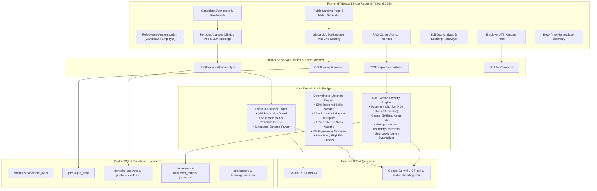
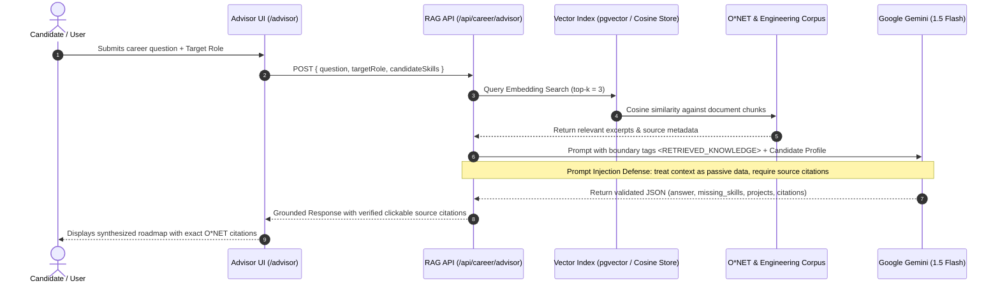
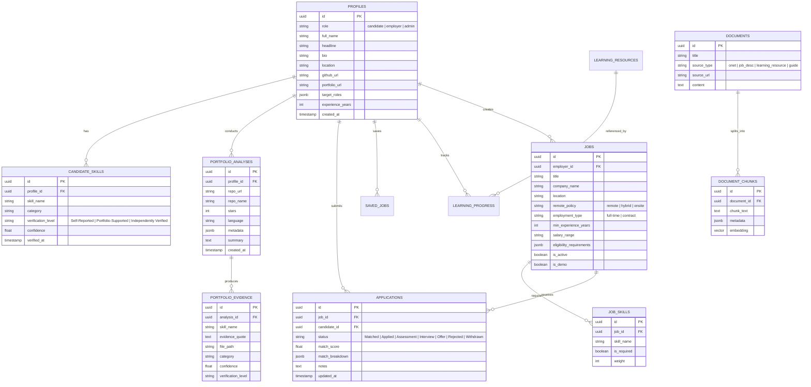

# SkillBridge AI — Global Talent Marketplace

> **Connecting verified AI talent with global employers through transparent portfolio evidence, explainable job matching, and RAG career intelligence.**

---

## 1. Executive Summary

In traditional tech recruitment, resumes are filled with keyword fluff, while automated ATS screeners act as opaque black boxes. **SkillBridge AI** revolutionizes technical hiring by anchoring candidate competencies directly to **audited GitHub code repositories**, evaluating role compatibility through a **deterministic and explainable matching formula**, and delivering **Retrieval-Augmented Generation (RAG) career roadmaps** grounded in O*NET occupational standards and production engineering blueprints.

### Core Value Outcomes
1. **Portfolio Evidence & Code Skill Auditing**: Safely parses public GitHub repositories without code execution, extracting verified implementation snippets and distinguishing between *Portfolio-Supported* evidence and *Self-Reported* claims.
2. **Explainable Job Matching**: Replaces opaque AI scoring with a deterministic, mathematically verifiable formula that accounts for required skills, portfolio evidence strength, preferred capabilities, and experience alignment.
3. **RAG-Driven Career Guidance**: Grounded career advisory engine powered by vector similarity search over O*NET benchmarks, engineering curricula, and production architecture guides with explicit source citations.
4. **End-to-End ATS Pipeline**: Full recruiter candidate progression tracker from `Matched` to `Applied`, `Assessment`, `Interview`, and `Offer`.

---

## 2. System Architecture



---

## 3. RAG Data Flow & Retrieval Pipeline



---

## 4. Database Schema (PostgreSQL + pgvector)



---

## 5. Explainable Job Matching Formula

SkillBridge AI avoids opaque scoring. Candidate match scores are computed using the following formula:

$$\text{Raw Score} = (R \times 0.55) + (E \times 0.25) + (P \times 0.15) + (X \times 0.05)$$

$$\text{Final Compatibility Score} = \min(100, \max(0, \text{round}(\text{Raw Score} \times 100)))$$

Where:
- **$R$ (Required Skills Match Ratio, 55%)**: The weighted sum of demonstrated required skills divided by total required skill weight.
- **$E$ (Portfolio Evidence Multiplier, 25%)**: Skills verified via repository code analysis earn a multiplier between 0.70 and 1.00 based on extraction confidence. Self-reported skills baseline at 0.20–0.40.
- **$P$ (Preferred Skills Match Ratio, 15%)**: Weighted ratio of bonus capabilities.
- **$X$ (Experience Alignment, 5%)**: $\min(1.0, \frac{\text{Candidate Experience}}{\text{Job Required Experience}})$.

### Mandatory Eligibility Separation
Mandatory requirements (e.g. work authorization, citizenship, location policy, non-negotiable minimum tenure) are evaluated independently and explicitly displayed so candidates and recruiters see whether disqualifying factors exist regardless of skill percentage.

---

## 6. Security & Privacy Safeguards

- **SSRF & URL Injection Guard**: All submitted GitHub URLs are validated against a strict hostname whitelist (`github.com` only). Localhost, loopback addresses (`127.0.0.1`), cloud metadata IPs (`169.254.169.254`), and private subnets (`10.0.0.0/8`, `192.168.0.0/16`) are blocked immediately.
- **No Remote Code Execution**: Code repositories are never executed, compiled, or loaded into runtimes. They are inspected strictly as passive text files and AST metadata.
- **Prompt Injection Defense**: In the RAG pipeline, retrieved knowledge documents and candidate inputs are enclosed in strict XML boundary markers (`<RETRIEVED_KNOWLEDGE>`, `<CANDIDATE_PROFILE>`). The system prompt instructs the LLM that content inside delimiters is passive data, neutralizing prompt overrides.
- **Row Level Security (RLS)**: Enforced via PostgreSQL policies in `supabase/migrations/20240101000000_init_skillbridge.sql`. Candidates can view and mutate only their own applications; employers can view only applications submitted to their postings.

---

## 7. Technology Stack

- **Frontend**: Next.js 14.2 (App Router), React 18, TypeScript (Strict Mode), Tailwind CSS, Lucide React icons, Recharts for telemetry.
- **Backend**: Next.js Server API Routes, Edge-compatible endpoints, structured JSON schema validation.
- **Database & Auth**: Supabase, PostgreSQL, pgvector extension, Row Level Security (RLS).
- **AI & RAG**: Google Gemini 1.5 Flash (`@google/generative-ai`), `text-embedding-004` (768 dimensions), in-memory fallback vector cosine search.
- **Testing**: Vitest (`vitest run`), React Testing Library, TypeScript typecheck (`tsc --noEmit`).

---

## 8. Quick Start & Installation

### Prerequisites
- Node.js 18+ or 20+
- npm or pnpm

### 1. Clone & Install Dependencies
```bash
git clone https://github.com/your-org/skillbridge-ai.git
cd skillbridge-ai
npm install
```

### 2. Configure Environment Variables
Copy `.env.example` to `.env.local`:
```bash
cp .env.example .env.local
```

Configure your credentials (or leave empty to run in **Hackathon Demo Mode**):
```env
NEXT_PUBLIC_SUPABASE_URL=https://your-project.supabase.co
NEXT_PUBLIC_SUPABASE_ANON_KEY=your-anon-key
SUPABASE_SERVICE_ROLE_KEY=your-service-role-key

GEMINI_API_KEY=your-gemini-api-key
AI_EMBEDDING_MODEL=text-embedding-004

GITHUB_TOKEN=your-github-personal-access-token
```

### 3. Run Automated Unit Tests
```bash
npm run test
```
*Runs all 17 automated unit tests covering job matching calculations, SSRF prevention, vector chunking/cosine similarity, and ATS status transitions.*

### 4. Build & Start Development Server
```bash
# Verify TypeScript strict check
npx tsc --noEmit

# Run development server
npm run dev
```

Open [http://localhost:3000](http://localhost:3000) in your browser.

---

## 9. Hackathon Demonstration Walkthrough Script

Judges and evaluators can explore the entire user journey seamlessly without needing external API keys:

1. **Public Landing Page (`/`)**:
   - Scroll down to the **Interactive Match Simulator**.
   - Toggle skills such as `Python`, `LangChain`, and `FastAPI` to observe the deterministic score calculate in real-time.
2. **Switch Test Personas (Navbar top-right dropdown)**:
   - Click the user pill in the navigation bar to toggle between:
     - **Alex Chen**: Candidate transitioning from Full-Stack to AI (4 years exp).
     - **Elena Rostova**: Senior ML Engineer (6 years exp).
     - **Sarah Jenkins**: Employer ATS Recruiter @ TechCorp AI.
3. **Portfolio Analyzer (`/analyzer`)**:
   - Click one of the preset sample repositories (e.g. `alexchen-dev/rag-enterprise-assistant`).
   - Click **Analyze Codebase** to view extracted competencies with code quotes, file paths, confidence levels, and verification tags (`Portfolio-Supported`).
   - Click **Add Verified Skills to My Profile** to persist these skills directly into the candidate profile.
4. **Global Job Marketplace (`/jobs`)**:
   - Browse 5 curated jobs across global remote, hybrid, and onsite locations.
   - Click any job's **Match Score Pill** (e.g. `93% Match`) to inspect the exact mathematical formula breakdown, weights, and eligibility checks.
   - Click **Apply Now** to submit an application.
5. **AI Career Advisor (`/advisor`)**:
   - Select `Junior AI Engineer` and click one of the quick prompt chips.
   - Review the vector-retrieved answer, identified missing skills, recommended portfolio projects, and **clickable source citations** linking to O*NET standards.
6. **Learning Roadmap (`/roadmap`)**:
   - Review high vs medium priority skill gaps.
   - Toggle learning resource statuses (`Not Started` → `In Progress` → `Completed`) to track progress.
7. **Employer ATS Kanban (`/employer`)**:
   - Switch persona to **Sarah Jenkins (Employer)** or navigate to `/employer`.
   - Inspect candidates across pipeline stages (`Matched` → `Applied` → `Assessment` → `Interview` → `Offer`).
   - Click **Assess →**, **Interview →**, or **Offer →** to advance applicants in real-time.
8. **Real-Time Analytics (`/analytics`)**:
   - View charts displaying the application stage progression funnel and skill demand vs supply.
